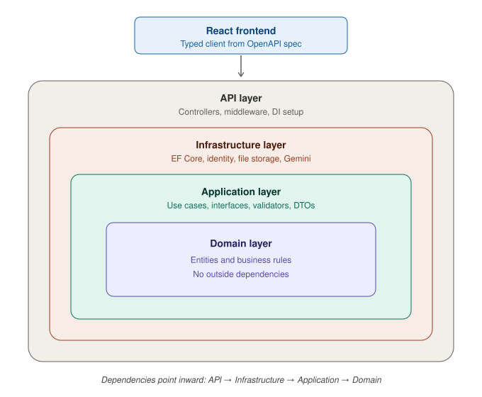

 

# ReelState

A social real-estate platform with short-form video listings, like TikTok or Instagram Reels but for property. Agents post short vertical videos of properties, and users can like, comment, follow agents, and get notified about new posts.

**Live demo:** https://reel-state3.vercel.app

## What it does

- Agents publish short vertical videos, photos, and location details for property listings
- Users browse a video feed, search, like, comment, follow agents, and receive real-time notifications
- AI-powered property search using RAG with Gemini: listings from SQL Server are passed to Gemini, which returns validated matches with a reason for each
- Authentication with JWT access and refresh tokens, plus Google OAuth 2.0 sign-in
- Three roles: users, agents, and admins, with policy-based authorization
- Admin tools for managing listings and users

## Tech stack

| Area | Technologies |
|------|--------------|
| Backend | ASP.NET Core Web API (.NET 9), Entity Framework Core, SQL Server, SignalR |
| Auth and security | ASP.NET Core Identity, JWT bearer tokens, Google OAuth 2.0, rate limiting, FluentValidation |
| Performance | Redis caching, indexing, no-tracking queries |
| AI | Gemini (RAG property search) |
| Frontend | React, TypeScript, Redux |
| Media storage | Cloudinary |
| DevOps | Docker Compose, GitHub Actions (CI/CD) |
| Observability | Serilog, health checks |
| Docs | Swagger / OpenAPI |

## Architecture

The backend follows Clean Architecture in four layers:

- **Domain:** entities and business rules
- **Application:** use cases, interfaces, validators, and DTOs
- **Infrastructure:** EF Core, identity, file storage, and external services like Gemini
- **API:** controllers, middleware, and dependency injection setup



Dependencies point inward, so the business logic doesn't depend on the database or the web framework. The React frontend talks to the API through a typed client generated from the OpenAPI spec.

Other details:

- Versioned REST API with controllers for Auth, Properties, Comments, Comment Likes, Likes, Follows, Notifications, User Activity, and Admin
- Database modeled with EF Core Code-First and evolved through 16 incremental migrations
- Search latency reduced from about 182 ms to 12 ms (median) with indexing, no-tracking queries, and Redis caching
- Frontend organized by feature: auth, dashboard, property, profile, admin, notifications, and AI

## Running locally

You need a SQL Server instance, and your connection string and JWT/Google OAuth/Gemini secrets configured in `appsettings.json` or environment variables.

**Backend**

```bash
cd ReelState.Server
dotnet restore
dotnet ef database update
dotnet run
```

**Frontend**

```bash
cd reelstate.client
npm install
npm run dev
```

## Testing and CI

- **Backend:** 33 xUnit tests, including Moq unit tests and `WebApplicationFactory` integration tests (authentication, role-based access, API versioning, rate limiting)
- **Frontend:** 17 tests with Vitest and React Testing Library
- **CI:** GitHub Actions runs both suites on every push and pull request

Run the tests locally:

```bash
dotnet test
cd reelstate.client && npm test
```


## Author

**Mouez Belkahla**: [Portfolio](https://mouez-belkahla.vercel.app/) · [LinkedIn](https://www.linkedin.com/in/mouez-belkahla-5ba46817b/) · [GitHub](https://github.com/Mouez-BELKAHLA)
